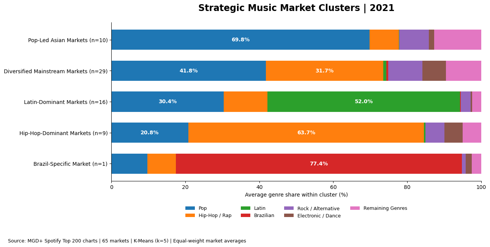

# Robyn Moore | Music Analytics Portfolio

Five case studies on streaming performance, fan behavior, marketing spend, international release strategy, and hit classification. Each one starts from a decision a label or marketing team would face and ends with something they could test.

**Tools:** SQL (PostgreSQL) · Python (pandas, scikit-learn) · Power BI · Tableau · Excel

**Contact:** [LinkedIn](https://www.linkedin.com/in/robyn-j-moore/) · [GitHub profile](https://github.com/robynjanee30)

| Project | Question | Headline finding | Tools |
| --- | --- | --- | --- |
| [1. Spotify Streaming Analytics](spotify-streaming-analytics/) | Where are artists gaining momentum, and what could explain it? | João Gomes gained 414.1M chart streams from H1 to H2 2021 across several tracks. Baby Keem gained 129.0M, with 81% of his H2 volume from one track. | PostgreSQL, Power BI |
| [2. Audience Segmentation & Fan Strategy](audience-segmentation-fan-strategy/) | Which listeners are more likely to explore new artists? | Two behavioral segments. At equal play volume, the higher-volume segment heard about 1.38× as many distinct artists. | Python, scikit-learn |
| [3. Marketing Campaign Performance & Budget Optimization](marketing-campaign-budget-optimization/) | Where should the next ad dollar go? | Ad spend returned 0.88× overall. The best recurring theme returned 0.93×, so a $10,000 test mix still needs an 8.87% revenue lift to cover media cost. | Excel, Tableau |
| [4. Global Music Market & Genre Trends](global-music-market-genre-trends/) | Where could a UK artist test an international release? | Lithuania and Australia shortlisted for Rock / Alternative, the Netherlands and Belgium for Electronic / Dance. | Python, scikit-learn |
| [5. Billboard Hit Classification](billboard-hit-classification/) | How well do audio features distinguish historical Billboard hits? | A modest signal: test ROC-AUC of 0.678, with 44.3% hit precision. Too many false positives for an automatic shortlist. | Python, scikit-learn |

Each project folder contains a README with the findings and method, a short case-study PDF, and the code or working files behind the numbers.

## Selected views

