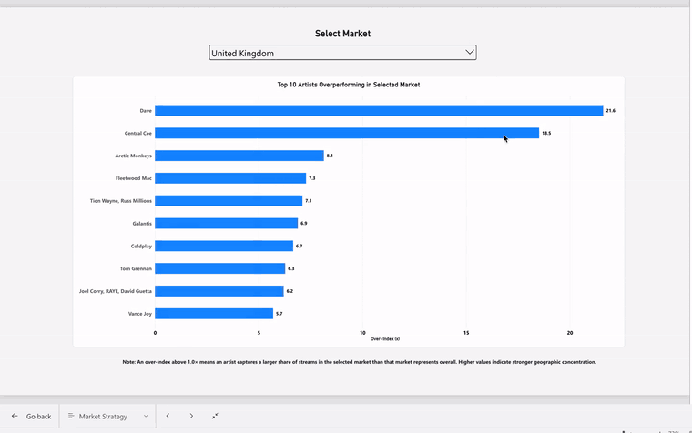
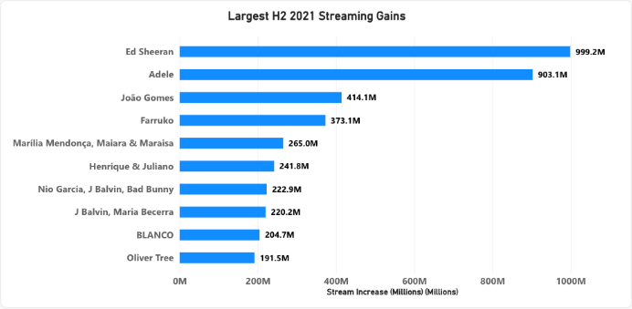

# Robyn Moore | Music Analytics Portfolio

Five case studies on streaming performance, fan behavior, marketing spend, international release strategy, and hit classification.

| Project | Question | Tools |
| --- | --- | --- |
| [1. Spotify Streaming Analytics](#project-1-spotify-streaming-analytics) | Where are artists gaining momentum, and what could explain it? | PostgreSQL, Power BI |
| [2. Audience Segmentation & Fan Strategy](audience-segmentation-fan-strategy/) | How do listening intensity and artist breadth vary across fan segments? | Python, scikit-learn |
| [3. Marketing Campaign Performance & Budget Optimization](marketing-campaign-budget-optimization/) | Where should the next ad dollar go? | Excel, Tableau |
| [4. Global Music Market & Genre Trends](global-music-market-genre-trends/) | Where could a UK artist test an international release? | Python, scikit-learn |
| [5. Billboard Hit Classification](billboard-hit-classification/) | How well do audio features distinguish historical Billboard hits? | Python, scikit-learn |

## Project 1. Spotify Streaming Analytics

A fictional record label wants to know which markets deserve a closer look and what drives an artist’s streaming gains. I used PostgreSQL and DBeaver to analyze historical Spotify Charts records and Power BI to build a dashboard.

### What I found

- **Scale.** Ed Sheeran led artist credits with 10.52B recorded chart streams. The Weeknd’s “Blinding Lights” led tracks at 2.56B. The United States led markets at 142.13B.
- **Geography.** Mata and sanah each over-indexed 56.9× in Poland in 2021. The index compares the artist’s share of streams from Poland with Poland’s share of all included chart streams. I paired the index with volume thresholds to surface markets worth researching for local promotion.
- **Momentum.** João Gomes gained 414.1M recorded chart streams from H1 to H2 2021, with 60% of H2 volume across his two leading tracks. Baby Keem gained 129.0M, with 81% of H2 volume from “family ties.” I’d test a multi-track campaign for João Gomes and use Baby Keem’s breakout to introduce listeners to the rest of his catalog.

### Power BI dashboard

[Watch the Power BI walkthrough](assets/power-bi-walkthrough.mp4) (1:33, no audio). The recording shows the streaming overview, the market filter, and the 2021 artist and track momentum views.

This chart ranks the artists in the momentum sample by absolute stream gain from H1 to H2 2021. João Gomes gained 414.1 million chart streams over that period.

### Project files

| Path | Contents |
| --- | --- |
| [PostgreSQL queries](sql/analysis.sql) | Eight read-only PostgreSQL queries for the rankings, over-index and momentum analysis |
| [Case study PDF](case-study.pdf) | Findings, charts, and recommendations |

The SQL expects a prepared PostgreSQL table named `charts` scoped to 2017–2021. Required fields are `date` (date or timestamp), `artist`, `title` and `region` (text), and `streams` (numeric, nullable). Run the statements in order or individually. Each query is labeled with its corresponding export. Download the source CSV from [Spotify Charts on Kaggle](https://www.kaggle.com/datasets/dhruvildave/spotify-charts), published by Dhruvil Dave.

### Method notes

The analysis excludes missing stream counts and the aggregate Global chart. The 2021 comparisons also exclude South Korea because its chart series began partway through the year. Artist credits stay as written, so collaborative credits are grouped separately. The two case-study track queries consolidate title capitalization variants.

Market over-index uses the artist’s share of streams from a market divided by the market’s share of all included streams. The index is capped at the inverse of the market’s share of all included chart streams. Mata and sanah both reached Poland’s 56.9× ceiling because their included chart streams were all in Poland. Read the index alongside absolute volume and market share. The screen requires 100M streams for the artist credit and 10M for the artist-market pair. The momentum sample requires at least 1M H1 streams, 10M H2 streams and a gain of 100M, then keeps up to 20 credits ranked by percentage growth.

Chart streams capture charting activity. Market coverage changed over time, and these historical results do not establish what caused the growth.
