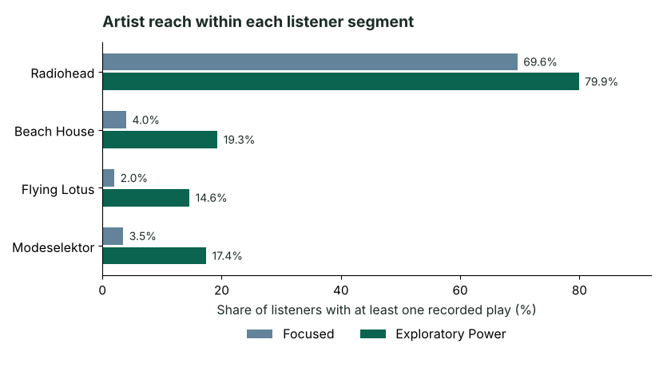

# Audience Segmentation & Fan Strategy

Robyn Moore · Music analytics portfolio · Python, pandas, scikit-learn

**How can a label use listening behavior to decide who might respond to artist discovery or catalog re-engagement?** I used historical Last.fm listening histories to identify two behavioral segments, then compared artist reach and audience affinity to design campaign tests.

[Read the case study](case-study.pdf) · [View the Python notebook](audience-segmentation.ipynb) · [Portfolio home](../)

## What I found

The original full-cohort analysis parsed **19,098,853 events across 992 users**. The 500-play minimum retained **926 listeners**.

| Historical cohort average | Focused Listeners | Exploratory Power Listeners |
| --- | ---: | ---: |
| Listeners | 454 (49%) | 472 (51%) |
| Plays per observation day | 9.67 | 42.19 |
| Artist breadth per observation day | 0.62 | 2.49 |
| Share of plays for top artist | 8.67% | 5.92% |
| Active-day rate | 28.22% | 71.36% |

Artist breadth divides the number of distinct artist names across a listener’s history by their observation days. The Exploratory Power segment logged about 4.4× more plays per day and about four times the artist breadth per day.

**Reach and affinity tell different stories.** Radiohead reached 693 listeners and indexed at 1.15×. Beach House reached 19.28% of Exploratory Power Listeners and 3.96% of Focused Listeners, an index of 4.86×. Flying Lotus indexed at 7.37×, with 14.62% penetration in the Exploratory Power segment.

Radiohead shows broad reach in both segments. Beach House, Flying Lotus and Modeselektor (3.5% of Focused and 17.4% of Exploratory Power Listeners) reach far fewer listeners overall and are concentrated in the higher-volume segment.

**Is the higher-volume segment really more exploratory?** Distinct artists grow more slowly than plays, so I compared listeners at similar play volumes.

| Total plays | Median artists, Focused | Median artists, Exploratory Power | Ratio |
| --- | ---: | ---: | ---: |
| 2,000–4,999 | 329 | 480 | 1.46× |
| 5,000–9,999 | 554 | 698 | 1.26× |
| 10,000–19,999 | 583 | 929 | 1.59× |
| 20,000–39,999 | 628 | 1,153 | 1.84× |

Across the cohort, Exploratory Power Listeners heard about 1.38× as many distinct artists at equal play volume (95% CI 1.24–1.53). Artist breadth per day was a clustering input, so part of that gap follows from how the segments were formed. The notebook shows all six bands and the regression.

**What the affinity ratios can support.** A high-volume listener has more chances to play any given artist at least once, so the reach-based over-index values are descriptive. They do not isolate artist preference from listening volume.

## What I’d test

- **Discovery for Exploratory Power Listeners.** Test an adjacent-artist recommendation seeded by a high-affinity artist. Measure first-time artist listens and repeat listening against a holdout.
- **Catalog re-engagement for Focused Listeners.** Test a recommendation anchored in a familiar artist. Measure catalog plays and repeat engagement against a holdout.

## How the model was checked

I standardized four behavioral features and compared K-Means solutions from k=2 to k=8. The two-cluster solution led with a silhouette score of 0.3323. Raising the minimum history to 1,000 plays preserved 870 of 890 overlapping assignments (97.75%). The score supports directional profiles. The historical cohort and inconsistent artist metadata limit generalization to current audiences.

## Run the analysis

1. Download the full `userid-timestamp-artid-artname-traid-traname.tsv.zip` from the [Last.fm 1K data release](https://github.com/eifuentes/lastfm-dataset-1K/releases) and place it beside the notebook.
2. Install the dependencies with `python -m pip install -r requirements.txt`, then open `audience-segmentation.ipynb` in JupyterLab and run all cells. The code reads the event archive in chunks.
3. The notebook is published without saved cell outputs and records the original aggregate results as notes under each step. The full archive is required to reproduce the historical figures. A 50-user Parquet subset from the same release was used for exploration only. Raw histories and demographics are omitted from this repository.

Source: Òscar Celma’s Last.fm 1K user dataset, released via the mirror linked above.
