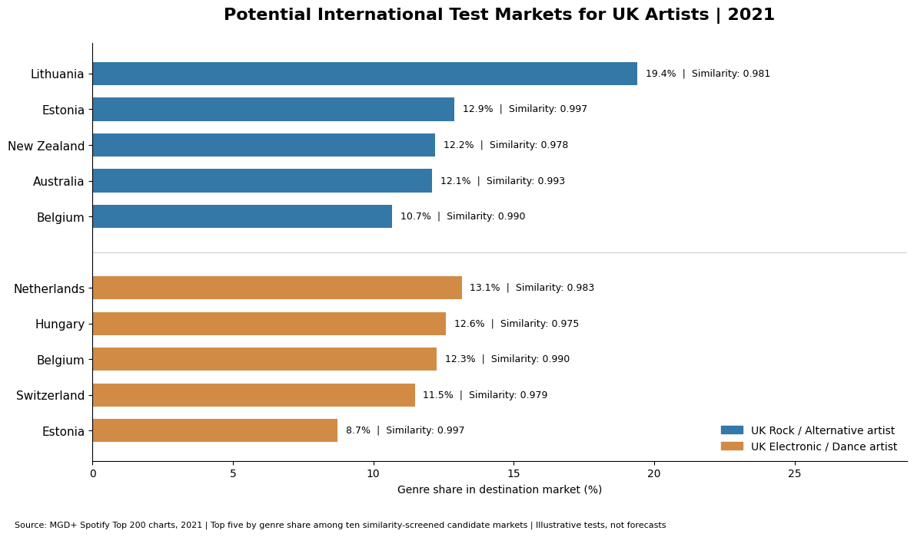
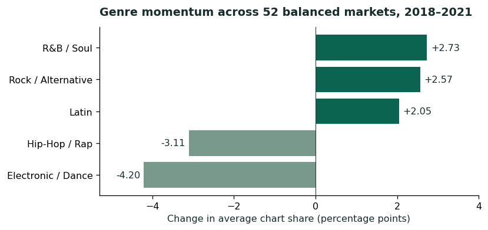
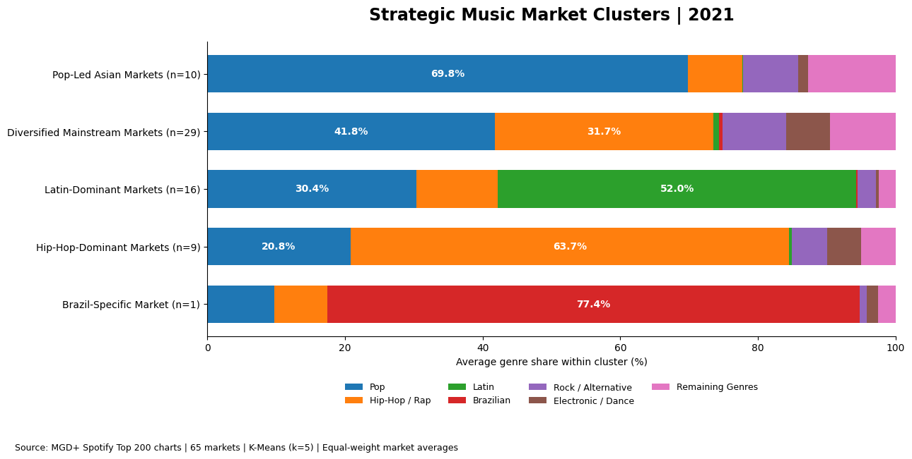

# Global Music Market & Genre Trends

Robyn Moore · Music analytics portfolio · Python, pandas, scikit-learn

**Where should a UK artist test a release internationally?** I compared genre share, historical momentum, and market similarity across Spotify Top 200 charts to narrow down test territories for UK repertoire.

[Read the case study](case-study.pdf) · [View the analysis notebook](market-genre-analysis.ipynb) · [Download the aggregate results](aggregate-results.zip) · [Portfolio home](../)

## UK release test shortlist

| Repertoire | Candidate | Genre share of classified chart streams | Similarity to UK |
| --- | --- | ---: | ---: |
| Rock / Alternative | Lithuania | 19.39% | 0.981 |
| Rock / Alternative | Australia | 12.08% | 0.993 |
| Electronic / Dance | Netherlands | 13.14% | 0.983 |
| Electronic / Dance | Belgium | 12.26% | 0.990 |

These examples balance genre demand with similarity across the full 17-genre profile. Before committing budget, I’d check artist-level audience geography and run small release pilots, measuring saves, repeat listening, and cost per incremental listener.

## What I found

- **Genre reach varies.** Pop reached at least 5% share in all 65 markets with 12 months of 2021 coverage. Latin met that threshold in 16 markets and Brazilian genres in two.
- **Local momentum can diverge from the wider trend.** Hip-Hop / Rap gained 32.68 percentage points in Greece, while its unweighted average share fell 3.11 points across the 52 markets with all 48 months present from 2018 to 2021.
- **The five clusters give campaign teams more detail.** The two-cluster solution scored highest on silhouette (0.530). I selected five clusters (0.521) for finer profiles and treated the Brazil-only cluster as an outlier.

## Analysis notebook

The [analysis notebook](market-genre-analysis.ipynb) holds the full pipeline with saved outputs. It loads 21.26M chart rows across the market files, removes duplicates, joins each track to its first credited artist’s main genre, and maps that genre to one of 17 families with an ordered keyword rule set. It then builds every table in the archive and the charts on this page. The notebook was written for Google Colab and expects the MGD+ chart, song and artist files under `/content`. Change `ROOT` to run it elsewhere.

## Data and verification

The source is [MGD+ on Zenodo](https://zenodo.org/records/8086643) by Danilo B. Seufitelli, Gabriel P. Oliveira, Mariana O. Silva, and Mirella M. Moro. The archive here contains ten aggregate result tables, including the monthly market-and-genre input, the original quality summary, market profiles, and UK shortlists.

Run `python -m pip install -r requirements.txt` and then `python verify_results.py`. The script recalculates shares, over-index, reach, balanced trends, market-level changes, clustering and shortlist metrics from the aggregate exports. It reproduces the exported five-cluster assignments. The script starts from the aggregate exports, so it does not need the source files.

Genre share excludes Unknown and Other. Over-index divides a market’s genre share by the unweighted 2021 market average. The findings describe historical chart activity, and genre tags and chart coverage affect comparisons.
