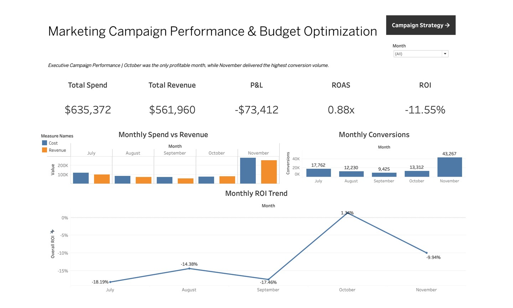

# Marketing Campaign Performance & Budget Optimization

Robyn Moore · Analytics portfolio · Excel and Tableau

**Where should the next advertising dollar go?** I analyzed 190 ad-group-month observations from July through November 2021, rebuilt the campaign KPIs, and modeled a $10,000 test budget.

[Read the case study](case-study.pdf) · [Excel workbook](final_shop_6modata.xlsx) · [Tableau workbook](campaign-dashboards.twbx) · [Recalculate the KPIs](verify_metrics.py) · [Portfolio home](../)

## What I found

| Measure | July–November 2021 |
| --- | ---: |
| Ad spend | $635,372 |
| Tracked revenue | $561,960 |
| Revenue less ad spend | −$73,412 |
| ROAS | 0.88× |
| Media ROI | −11.55% |

- **Conversion volume was a poor proxy for return.** November drove 43,267 conversions and returned 0.90× on ad spend. October was the only month above 1.00×.
- **Promo Code led the recurring themes at 0.93× ROAS.** Sale returned 0.40×. Black Friday/Cyber Monday returned 4.36× across two records and $47 of spend, so I treated it as a seasonal retest.
- **Desktop converted better than mobile.** Desktop converted 18.0% of clicks against 7.8% on mobile and returned 0.90× against 0.87×. By match type, 1:1 and Exact both returned 0.89× and Phrase 0.81×. No device or match type covered its ad spend.
- **The proposed mix still needs improvement.** Allocate $4,000 to Promo Code, $3,000 to Promo, $2,000 to Coupon Code and retain $1,000. Applying historical ROAS to the $9,000 deployed gives $8,267.03 in modeled revenue. Covering media spend requires $732.97 more, an 8.87% lift over modeled revenue.

## Tableau dashboard

The original Tableau labels “P&L” and “profitable” refer to tracked revenue less ad spend and media break-even. They exclude product margins and other operating costs.

[Campaign strategy view](tableau-campaign-strategy.jpg) · [Budget optimization view](tableau-budget-optimization.jpg)

## Excel decision support

[Campaign decision tool](excel-decision-tool.jpg) · [Budget reallocation scenario](excel-budget-scenario.jpg)

The decision tool retrieves weighted KPIs for a selected promotion and recommends an action based on performance and scale. The scenario applies historical theme ROAS to an editable allocation. The links above are screenshots. The [Excel workbook](final_shop_6modata.xlsx) and [Tableau workbook](campaign-dashboards.twbx) are included. The Tableau file is a packaged workbook with its data source bundled.

### How the workbook is built

| Sheet | What it does |
| --- | --- |
| Source table | 190 rows. Recalculates CTR, conversion rate, CPC, CPA, ROAS and ROI from raw counts. Parses device, match type and promotion theme from the ad-group name with nested `IF(ISNUMBER(SEARCH()))`. Assigns spend tiers from `QUARTILE.INC` cost cut-offs of $188.50, $563.50 and $2,967. |
| Five PivotTable sheets | Month, device, match type, promotion theme and spend tier, each with KPI columns calculated as ratios of sums. |
| Spend Efficiency | `CORREL` of row-level cost against revenue and ROAS. |
| Campaign Decision Tool | A Data Validation dropdown selects the theme. `XLOOKUP` returns its KPIs and `SUMIFS` / `COUNTIFS` return spend, revenue and record count. An `IFS` rule then recommends an action. |
| Budget Reallocation Scenario | Editable allocation percentages, `XLOOKUP` of each theme’s historical ROAS, an allocation check, and the break-even gap. |

The decision rule checks sample size first. A theme with fewer than five records returns “Promising but low-volume — test cautiously.” Otherwise the action follows media ROI: at or above 0% “Scale cautiously,” down to −10% “Prioritize & optimize,” down to −25% “Maintain & test,” and below that “Reduce or rework.”

## Data and methods

Source: [Shopping Mall Paid Search Campaign Dataset on Kaggle](https://www.kaggle.com/datasets/marceaxl82/shopping-mall-paid-search-campaign-dataset/data) by Marcello D, released under CC0: Public Domain. The [source CSV](final_shop_6modata.csv) is included. To reproduce the headline tables and scenario, run `python3 verify_metrics.py final_shop_6modata.csv` with Python 3.10 or later.

I recalculated the inconsistent source conversion rate from conversions and clicks and used ratios of sums for all aggregate efficiency metrics. Media ROI measures revenue less ad spend divided by ad spend. It excludes margin and other operating costs. The allocation is a historical scenario. Future budgets should be evaluated using controlled tests and incremental return.
